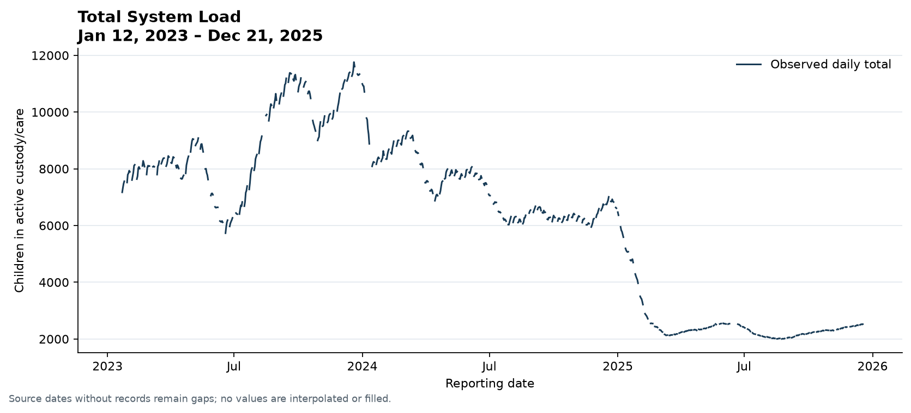
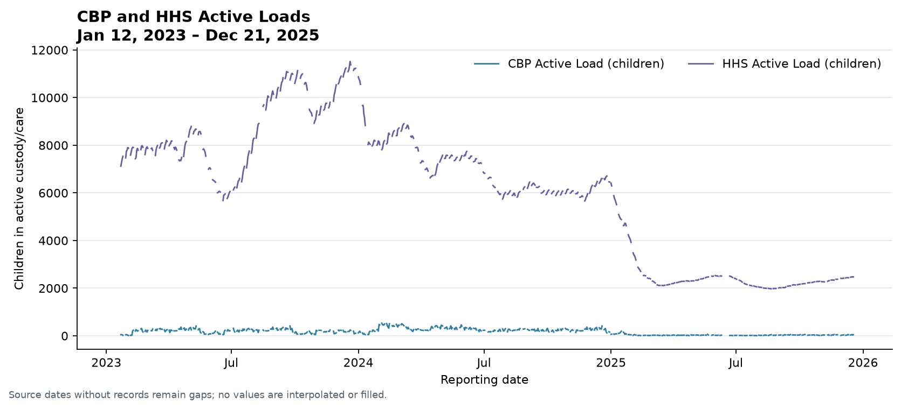
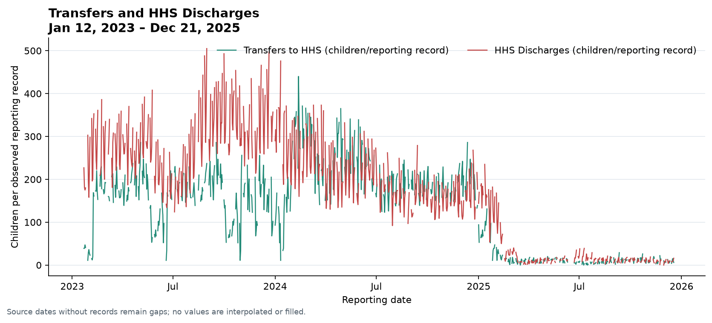
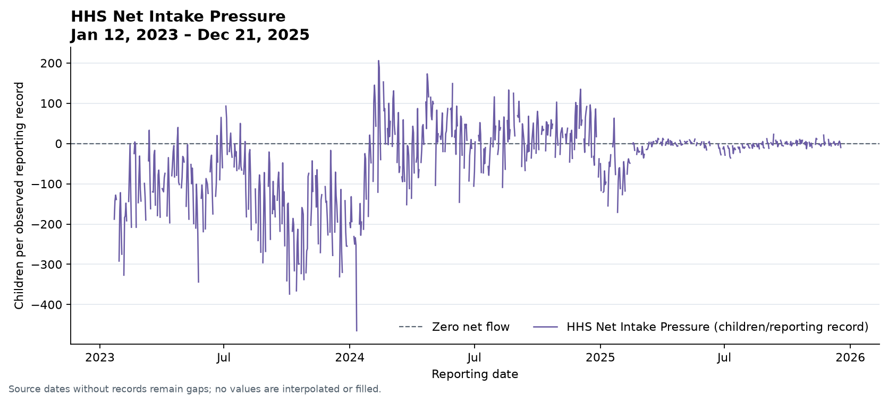
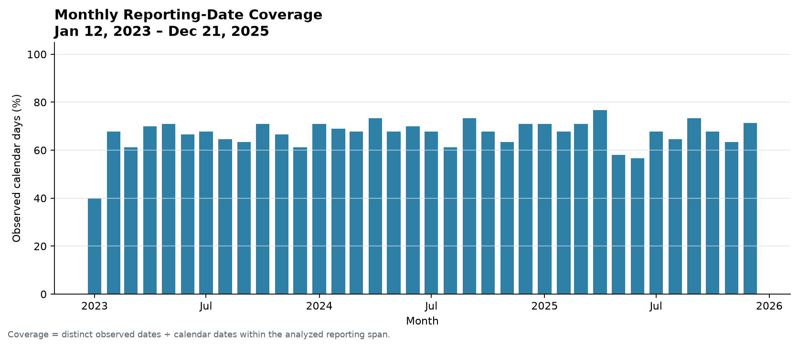
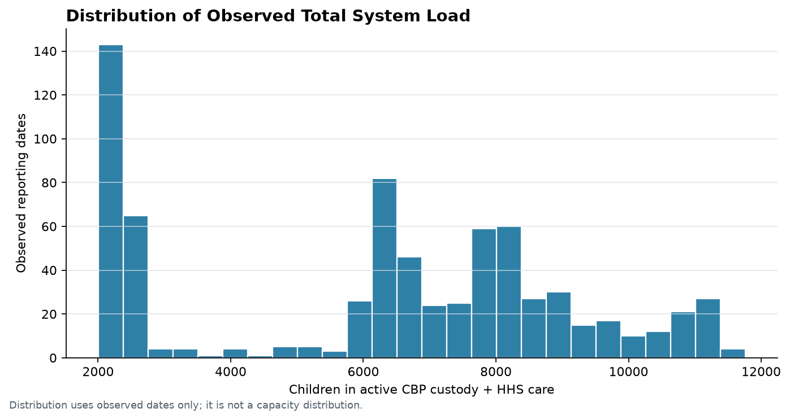

# System Capacity & Care Load Analytics for Unaccompanied Children

**Generated:** 2026-10-10 18:05 IST  
**Reporting dates:** January 12, 2023 through December 21, 2025  
**Source:** supplied `HHS_Unaccompanied_Alien_Children_Program.csv`; specification context from `Project 3.docx`.

## Abstract

This analysis describes aggregate CBP and HHS active-load counts, daily intake and transfer/discharge flows, relative load variation, and source-data coverage. It retains source values and missing reporting dates, and computes daily growth only across consecutive calendar dates. The file contains 720 nonblank source records across 1075 possible calendar dates (67.0% coverage), with 355 unreported dates. Therefore, flow totals are observed-record sums and relative peaks cannot establish facility capacity, overcrowding, delay, harm, or causal policy effects.

## Background and objectives

The supplied project specification frames the program as an operational care pipeline and calls for monitoring active load, intake/outflow balance, temporal pressure, and data quality. This analysis supports that monitoring purpose using only the provided aggregate counts. It asks: (1) how observed CBP and HHS active loads changed; (2) how recorded transfers compare with HHS discharges; (3) when observed load was relatively high or net flow positive; and (4) how incomplete reporting affects those readings.

The specification also describes potential staffing and shelter planning uses. The available fields do not include facility capacity, staffing, length of stay, location, health outcomes, or individual records, so this work does not evaluate adequacy or service performance.

## Dataset and source fields

The CSV contains 1170 raw data rows, including 450 completely blank rows. After excluding only those blank rows, 720 records remain. Parsed reporting dates span January 12, 2023 through December 21, 2025. The file is newest-first; the analysis sorts valid dates chronologically. Source row references retain CSV body line numbers.

| Source field | Internal name | Interpretation used |
| --- | --- | --- |
| `Date` | `date` | Reporting date |
| `Children apprehended and placed in CBP custody*` | `cbp_daily_intake` | Daily intake flow; the asterisk has no supplied footnote |
| `Children in CBP custody` | `cbp_custody` | Active CBP stock |
| `Children transferred out of CBP custody` | `transfers_to_hhs` | Daily transfer flow into HHS, following the DOCX wording |
| `Children in HHS Care` | `hhs_care` | Active HHS stock |
| `Children discharged from HHS Care` | `hhs_discharges` | Daily HHS discharge flow |

## Cleaning and reproducibility

The loader reads all source cells as text, counts fully blank rows, preserves the raw frame in memory, maps headings to stable internal names, parses dates, and removes commas before safe numeric conversion. It retains rows with invalid dates or count values and emits source-row flags. It sorts dated records and builds a complete calendar index from the minimum through maximum valid date. Inserted calendar rows remain `NaN` and are marked `is_observed = false`; no zero-fill, interpolation, or forward-fill is used. Duplicate dates are flagged and retained; duplicate-date values are not summed or averaged in the calendar index or period summaries.

Run `python -m uac_analytics.cli` from the project root to reproduce the processed CSVs, figures, and reports from the packaged raw file. Use `--input PATH` for an alternate CSV with the same required source headings.

## Data-quality assessment

- Calendar coverage is 67.0%: 720 observed dates of 1075 possible; 355 dates have no source row. The longest missing-date streak is 9 calendar days.
- Invalid dates: 0; duplicate-date rows: 0; exact duplicate source rows: 0.
- Missing count cells: 0; nonblank numeric conversion failures: 0; negative counts: 0; fractional counts: 0.
- The requested `transfers_to_hhs <= cbp_custody` comparison is exceeded on 86 rows. Transfers are a flow and CBP custody a stock, so the test is retained as a review flag rather than treated as a semantically definitive error.
- The requested `hhs_discharges <= hhs_care` comparison is exceeded on 0 rows.
- Consecutive-day changes outside the observed 1.5-IQR range are flagged for inspection and are never removed automatically.

The incomplete date series limits calendar-based rollups, especially weekly/monthly flow totals. Period flow sums below include observed reporting records only; they are not complete-period totals where coverage is below 100%.

## Metric definitions

| Metric | Formula and interpretation |
| --- | --- |
| Total System Load | `cbp_custody + hhs_care`, a sum of the two active stocks on the same observed date. |
| HHS Net Intake Pressure | `transfers_to_hhs - hhs_discharges`, a daily flow balance on an observed record. Positive values indicate recorded transfers exceeded recorded discharges for that record. |
| Care Load Growth Rate | `(total_system_load_t / total_system_load_(t-1)) - 1`; calculated only when both loads exist on consecutive calendar dates and the prior load is nonzero. |
| Cumulative observed-record pressure | Running sum of HHS Net Intake Pressure across observed records. It is a derived flow sum, not a measured backlog. |
| Cumulative observed stock sum | Running sum of observed Total System Load snapshots, in child-observations; not unique children or a complete person-day total. |
| Care Load Volatility Index | Sample standard deviation of valid observed Total System Load divided by its mean, multiplied by 100 (coefficient of variation). This descriptive statistic is not an official HHS standard. |
| Backlog Accumulation Rate | Mean of positive HHS Net Intake Pressure values per observed reporting record. This is a pressure proxy, not a direct backlog count or calendar-day rate. |
| Discharge Offset Ratio | 100 × sum of observed HHS discharges ÷ sum of observed transfers to HHS. Undefined when the transfer denominator is zero; not a placement success rate. |
| Rolling means | Calendar rolling 7-day/14-day averages for Total System Load, active stocks, intake, transfers, discharges, and HHS Net Intake Pressure; displayed only when at least 80% of dates in each window are observed. Coverage is provided alongside each rolling value. |
| Sustained positive-pressure window | Positive trailing 7-day mean HHS Net Intake Pressure with at least 80% calendar-date coverage; a pressure proxy, not a direct backlog. |
| Relative high-load threshold | The selected historical percentile of observed Total System Load. It is relative to this dataset and is not authorized capacity. |

## Methods

Daily plots use the complete calendar index and break lines at missing dates. Weekly and monthly stock summaries use means of observed reporting dates; flow sums are explicitly observed-record sums. Coverage is observed distinct dates divided by possible calendar dates in the selected period. Sustained positive-pressure windows require a positive trailing 7-day mean and at least 80% coverage of the seven calendar dates. Year summaries report observation counts and coverage. No forecasting model is fit: the conservative eligibility gate requires at least 90% coverage both overall and for the trailing 365 days, plus no reporting gap longer than 7 days.

## Results

### KPI summary

| KPI | Computed result | Definition and time basis |
| --- | --- | --- |
| Total Children Under Care | 2,502 on 2025-12-21 | Latest date with both active-load values; CBP custody + HHS care. |
| Net Intake Pressure | -32,212 | Sum across 720 observed reporting records. Positive means transfers exceeded discharges; negative means discharges exceeded transfers. Not a measured backlog. |
| Care Load Volatility Index | 46.8% | Sample standard deviation of valid observed Total System Load divided by its mean, multiplied by 100. Descriptive variability, not an official HHS standard. |
| Backlog Accumulation Rate | 38.7 children per positive observed reporting record | Mean of 238 positive HHS net-flow observations; a pressure proxy, not a directly measured backlog or calendar-day rate. |
| Discharge Offset Ratio | 134.8% | Observed-record HHS discharges divided by observed-record transfers to HHS, multiplied by 100; not a placement success rate. |

### Active loads and relative highs/lows

The latest date with both active-load components is **2025-12-21**, with a computed Total System Load of **2,502 children**. The largest observed total was **11,762 children on December 20, 2023**; the smallest was **2,002 children on August 24, 2025**. These are extrema among observed values only. The 90th percentile of observed Total System Load is **9,921 children**; **72** observations are at or above it. This is a historical relative threshold, not an overcapacity finding. Across dates with both stocks, mean observed load composition was **2.5% CBP** and **97.5% HHS**.

The sum of observed Total System Load snapshots is **4,487,594 child-observations** across reported dates. This sums repeated active-stock snapshots; it is not a count of unique children or a complete person-day total.

### Transfers, discharges, and pressure

Across observed records, net HHS flow pressure sums to **-32,212 children**; **238** observed records had positive pressure and **482** had zero or negative pressure. The aggregate discharge offset ratio is **134.8%**. The running observed-record flow sum is not a directly measured backlog and does not account for unreported dates.

- 2025-04-05 to 2025-04-16: positive 7-day observed-record mean HHS net flow; 6 consecutive qualifying window endpoints and minimum coverage 85.7%.

The table below reports descriptive statistics for observed count/flow fields and the derived stock/pressure measures. These summarize reporting records, not children uniquely served.

| Measure | N | Mean | Median | SD | Min | P25 | P75 | P95 | Max |
| --- | --- | --- | --- | --- | --- | --- | --- | --- | --- |
| cbp_daily_intake | 720 | 93.5 | 99.0 | 72.6 | 0 | 12.0 | 147.2 | 218.0 | 333 |
| cbp_custody | 720 | 171.5 | 193.0 | 126.4 | 7 | 36.0 | 263.2 | 380.6 | 531 |
| transfers_to_hhs | 720 | 128.7 | 157.0 | 97.3 | 0 | 14.0 | 199.2 | 282.2 | 440 |
| hhs_care | 720 | 6,061.3 | 6,406.5 | 2,833.1 | 1,972 | 2,467.8 | 8,010.2 | 10,744.8 | 11,516 |
| hhs_discharges | 720 | 173.4 | 181.0 | 125.7 | 0 | 19.8 | 267.0 | 375.0 | 505 |
| total_system_load | 720 | 6,232.8 | 6,633.5 | 2,918.5 | 2,002 | 2,500.8 | 8,249.5 | 10,964.3 | 11,762 |
| hhs_net_intake_pressure | 720 | -44.7 | -11.5 | 95.9 | -465 | -94.2 | 5.2 | 83.1 | 206 |

### Annual comparison

The date boundaries are calendar years intersected with the observed source span. Coverage and observed-date counts are included because differences in reporting completeness affect comparisons. `Net pressure sum*` is a sum of observed reporting records, not a complete annual total.

| Year | Observed dates | Possible dates | Coverage (%) | Mean load | Max load | Net pressure sum* |
| --- | --- | --- | --- | --- | --- | --- |
| 2023-01-01 00:00:00 | 230 | 354 | 65.0 | 8,846.5 | 11,762.0 | -30,120.0 |
| 2024-01-01 00:00:00 | 251 | 366 | 68.6 | 7,319.9 | 10,994.0 | 863.0 |
| 2025-01-01 00:00:00 | 239 | 355 | 67.3 | 2,575.7 | 6,471.0 | -2,955.0 |

Monthly row counts, coverage, mean load, and observed-record flow sums are provided below. Partial first/last months are clipped to the source reporting-date span.

| Month | Observed dates | Possible dates | Coverage (%) | Mean load | Net pressure sum* |
| --- | --- | --- | --- | --- | --- |
| 2023-01-01 00:00:00 | 8 | 20 | 40.0 | 7,413.5 | -1,580.0 |
| 2023-02-01 00:00:00 | 19 | 28 | 67.9 | 7,967.1 | -2,546.0 |
| 2023-03-01 00:00:00 | 19 | 31 | 61.3 | 8,190.5 | -1,976.0 |
| 2023-04-01 00:00:00 | 21 | 30 | 70.0 | 8,092.9 | -1,701.0 |
| 2023-05-01 00:00:00 | 22 | 31 | 71.0 | 8,404.1 | -2,634.0 |
| 2023-06-01 00:00:00 | 20 | 30 | 66.7 | 6,282.1 | -1,613.0 |
| 2023-07-01 00:00:00 | 21 | 31 | 67.7 | 7,073.4 | -510.0 |
| 2023-08-01 00:00:00 | 20 | 31 | 64.5 | 9,585.1 | -2,883.0 |
| 2023-09-01 00:00:00 | 19 | 30 | 63.3 | 10,992.4 | -2,575.0 |
| 2023-10-01 00:00:00 | 22 | 31 | 71.0 | 10,308.2 | -5,609.0 |
| 2023-11-01 00:00:00 | 20 | 30 | 66.7 | 9,909.6 | -2,794.0 |
| 2023-12-01 00:00:00 | 19 | 31 | 61.3 | 11,255.3 | -3,699.0 |
| 2024-01-01 00:00:00 | 22 | 31 | 71.0 | 9,021.6 | -3,646.0 |
| 2024-02-01 00:00:00 | 20 | 29 | 69.0 | 8,766.8 | 1,059.0 |
| 2024-03-01 00:00:00 | 21 | 31 | 67.7 | 8,703.9 | -469.0 |
| 2024-04-01 00:00:00 | 22 | 30 | 73.3 | 7,336.3 | 704.0 |
| 2024-05-01 00:00:00 | 21 | 31 | 67.7 | 7,836.0 | 858.0 |
| 2024-06-01 00:00:00 | 21 | 30 | 70.0 | 7,691.5 | -29.0 |
| 2024-07-01 00:00:00 | 21 | 31 | 67.7 | 6,498.8 | -220.0 |
| 2024-08-01 00:00:00 | 19 | 31 | 61.3 | 6,258.7 | 473.0 |
| 2024-09-01 00:00:00 | 22 | 30 | 73.3 | 6,452.6 | 295.0 |
| 2024-10-01 00:00:00 | 21 | 31 | 67.7 | 6,276.3 | 692.0 |
| 2024-11-01 00:00:00 | 19 | 30 | 63.3 | 6,151.4 | 413.0 |
| 2024-12-01 00:00:00 | 22 | 31 | 71.0 | 6,690.4 | 733.0 |
| 2025-01-01 00:00:00 | 22 | 31 | 71.0 | 5,080.0 | -1,580.0 |
| 2025-02-01 00:00:00 | 19 | 28 | 67.9 | 2,804.2 | -819.0 |
| 2025-03-01 00:00:00 | 22 | 31 | 71.0 | 2,185.9 | -119.0 |
| 2025-04-01 00:00:00 | 23 | 30 | 76.7 | 2,298.0 | 27.0 |
| 2025-05-01 00:00:00 | 18 | 31 | 58.1 | 2,439.8 | 47.0 |
| 2025-06-01 00:00:00 | 17 | 30 | 56.7 | 2,511.5 | -143.0 |
| 2025-07-01 00:00:00 | 21 | 31 | 67.7 | 2,201.1 | -308.0 |
| 2025-08-01 00:00:00 | 20 | 31 | 64.5 | 2,026.9 | -107.0 |
| 2025-09-01 00:00:00 | 22 | 30 | 73.3 | 2,118.0 | 23.0 |
| 2025-10-01 00:00:00 | 21 | 31 | 67.7 | 2,265.4 | 21.0 |
| 2025-11-01 00:00:00 | 19 | 30 | 63.3 | 2,360.7 | 23.0 |
| 2025-12-01 00:00:00 | 15 | 21 | 71.4 | 2,481.5 | -20.0 |

### Coverage and load distribution

## Operational interpretation and options for review

The observed counts can support situational awareness about the size and direction of recorded load and flow. Operational reviewers could compare the high-load dates with authorized facility-level capacity, staffing, and placement data if those sources are available; review whether the transfer and custody measures use compatible reporting windows; and prioritize restoration of a complete daily reporting series. The data do not establish which operational response caused a change or whether a particular count exceeded capacity.

## Limitations and responsible use

1. **Missing dates:** 355 of 1075 calendar dates lack a record. Period flow sums may omit unreported activity, and missing dates are never interpreted as zero.
2. **Flow-versus-stock comparison:** daily transfers and active CBP custody are different measure types; the flagged comparison may depend on source reporting conventions.
3. **No capacity denominator:** no authorized bed or facility capacity is supplied. No capacity percentage or overcapacity claim is possible.
4. **Unexplained asterisk:** the intake heading includes `*`, but the supplied material gives no corresponding footnote; its meaning is not inferred.
5. **Aggregate scope:** no facility, location, staffing, length-of-stay, health outcome, or individual-level fields are provided.
6. **No causal design or forecast:** the analysis is descriptive. Incomplete reporting fails the configured daily-forecast coverage gate (67.0% overall and 67.4% in the trailing 365 days; longest gap 9 days), so a forecast is disabled.

## Recommendations for reporting and monitoring

- Improve daily date completeness and publish the expected reporting calendar so coverage can be distinguished from zero activity.
- Document the reporting windows and definitions for intake, transfers, custody snapshots, and discharges, including the unexplained intake asterisk.
- Add authorized capacity and facility-level staffing context in a separate, governed source before evaluating capacity utilization or staffing adequacy.
- Review flagged anomalies with source owners; preserve original values and record any approved corrections through a documented revision process.
- Continue describing relative peaks as observed historical comparisons and pair them with coverage before operational interpretation.

## Conclusion

The supplied CSV supports transparent aggregate monitoring of active load and recorded flows, but not a finding about capacity stress, care delay, harm, or policy effectiveness. Daily coverage and measurement definitions are the main constraints on stronger operational inference.

## References

- `Project 3.docx`, supplied project specification and source-field dictionary.
- `HHS_Unaccompanied_Alien_Children_Program.csv`, supplied aggregate operational data.
